# Pitstop — a DevSecOps learning project

Pitstop is a garage-management microservices app (customer records,
vehicles, workshop scheduling) used here as raw material for an
end-to-end DevSecOps build: source code → CI → GitOps-deployed
Kubernetes → security-scanned pipeline → observability → optional
service mesh → optional cloud deployment. The application itself is
intentionally left at its original ~2022 vintage (Vue 2, Express 4,
Sequelize) — the point of the project is the platform built around it,
not a rewrite of the app.

This monorepo contains seven source directories:

| Repo | Role |
|---|---|
| [`pitstop-customer`](pitstop-customer/) | Customer records service (Node/Express/Sequelize, MySQL) |
| [`pitstop-vehicle`](pitstop-vehicle/) | Vehicle records service |
| [`pitstop-workshop`](pitstop-workshop/) | Workshop job scheduling service |
| [`pitstop-express-gateway`](pitstop-express-gateway/) | API gateway, single front door for the three backend services |
| [`pitstop-webapp`](pitstop-webapp/) | Vue.js frontend |
| [`pitstop-ci-templates`](pitstop-ci-templates/) | Shared GitLab CI templates for build, deploy, rules, and security jobs |
| [`pitstop-devops`](pitstop-devops/) | Kubernetes manifests, GitOps target, security/platform docs |

## Architecture

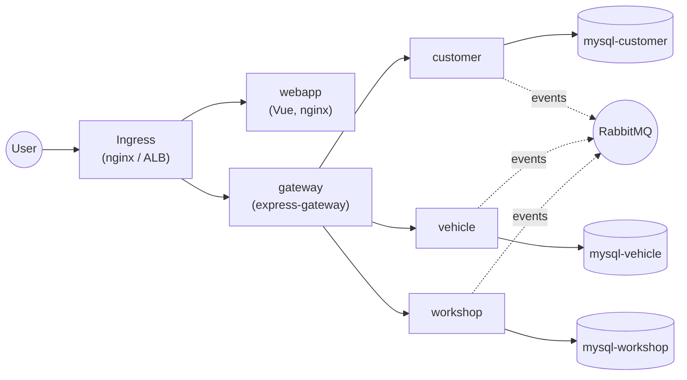

Five app repos are built by GitLab CI and deployed by Argo CD, which
watches the `pitstop-devops` directory. It holds no application code and no
plaintext credentials — only manifests, Sealed Secrets ciphertext, and
documentation.

---

## The journey

| Volet | Focus | Status |
|---|---|---|
| 1 | CI pipelines (build, tag, push) | ✅ done, all 5 services |
| 2 | GitOps deployment (Argo CD) | ✅ done |
| 3 | Pipeline & runtime security (SAST/SCA/container/DAST, secrets) | ✅ done |
| 4 | Observability (Prometheus, Grafana, Loki) | ✅ done |
| 4b | Service mesh (Istio mTLS + authorization) | ✅ done, optional |
| 5 | Cloud Kubernetes (AWS EKS) | ✅ done, optional |

Each section below is a summary — the full technical detail, including
every command and every root-cause investigation, lives in
[`pitstop-devops/docs/security.md`](pitstop-devops/docs/security.md), [`pitstop-devops/docs/eks.md`](pitstop-devops/docs/eks.md),
and [`pitstop-devops/k8s/platform/README.md`](pitstop-devops/k8s/platform/README.md).

---

## Volet 1 — CI pipelines

Each of the five app repos builds a multi-stage Docker image (non-root
runtime user, pinned base image, minimal final layer) and pushes it to
the GitLab Container Registry, tagged by commit SHA — never `latest`,
so a manifest's image tag always names an exact, reproducible build.

`pitstop-webapp` needed one additional fix: its Docker-in-Docker build
was silently stalling on large layer downloads. Root cause was an MTU
mismatch between the GitLab runner's network (1360) and Docker's
default (1500) — packets above 1360 bytes were being dropped with no
error, just a hang. Fixed by capping the build's MTU explicitly.

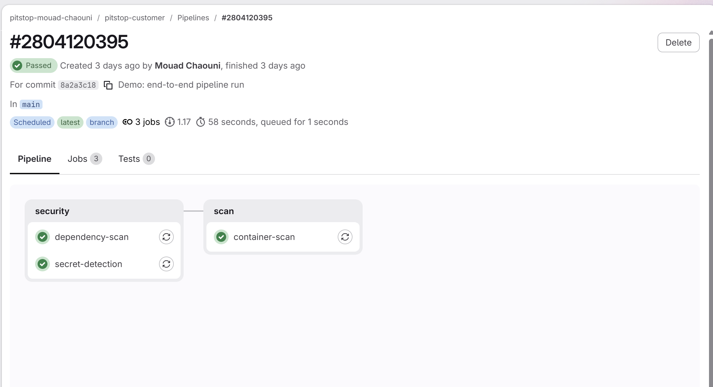
*A scheduled rescan run — by design it only runs `dependency-scan`,
`secret-detection`, and `container-scan`, skipping `sonarqube`/
`build-image`/`deploy` (which don't need to re-run against unchanged
code). Security stages visible here are the same ones covered in
Volet 3 below.*

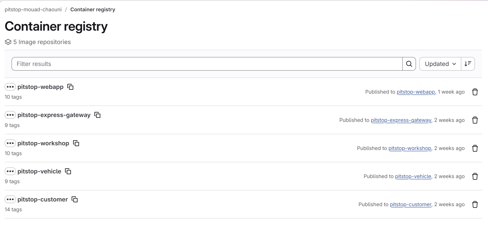

## Volet 2 — GitOps deployment (Argo CD)

Manifests were written and applied by hand first, then automated. Argo
CD watches this repository (`recurse: true`, directory-mode, no Helm
chart of its own) with `prune: true` and `selfHeal: true` — a `kubectl
edit` or `kubectl scale` against the live cluster reverts within
seconds, by design.

Each app repo's pipeline ends with a `deploy` stage: it clones this
repo, rewrites its own image tag, and pushes — using a dedicated SSH
deploy key per service, not a shared credential. CI never holds a
`kubeconfig`; it only ever writes to Git. Argo CD is the only thing
that ever talks to the cluster.

**Deliberately not in Git:** the `pitstop` namespace itself and all
Kubernetes `Secret`s are created by hand. This was a namespace-level
decision made specifically so that pruning could be safely turned on —
Argo CD only prunes resources it tracks, so hand-made objects are
invisible to it and survive a misconfigured sync.

**Verified, not assumed:** a trivial code change was pushed through the
full chain — CI build → registry push → manifest commit → Argo CD sync
— and landed in the live cluster with zero manual `kubectl apply`,
in under 7 minutes end-to-end.

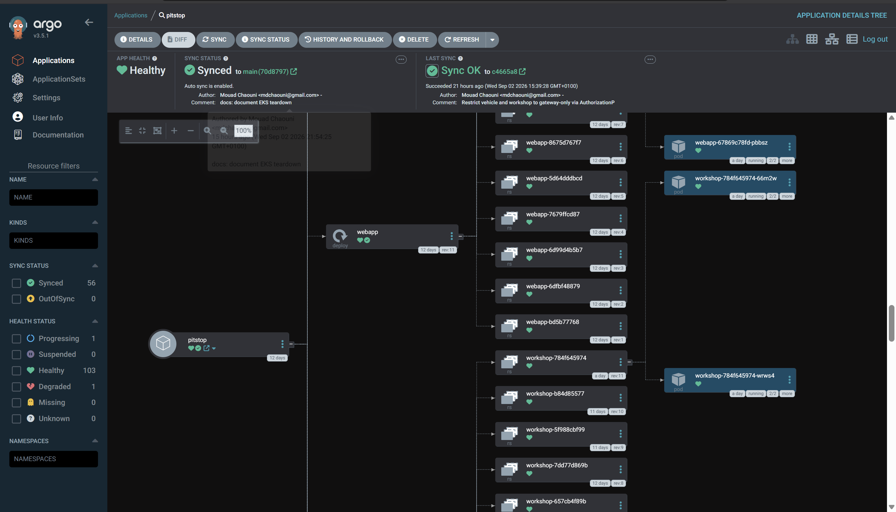

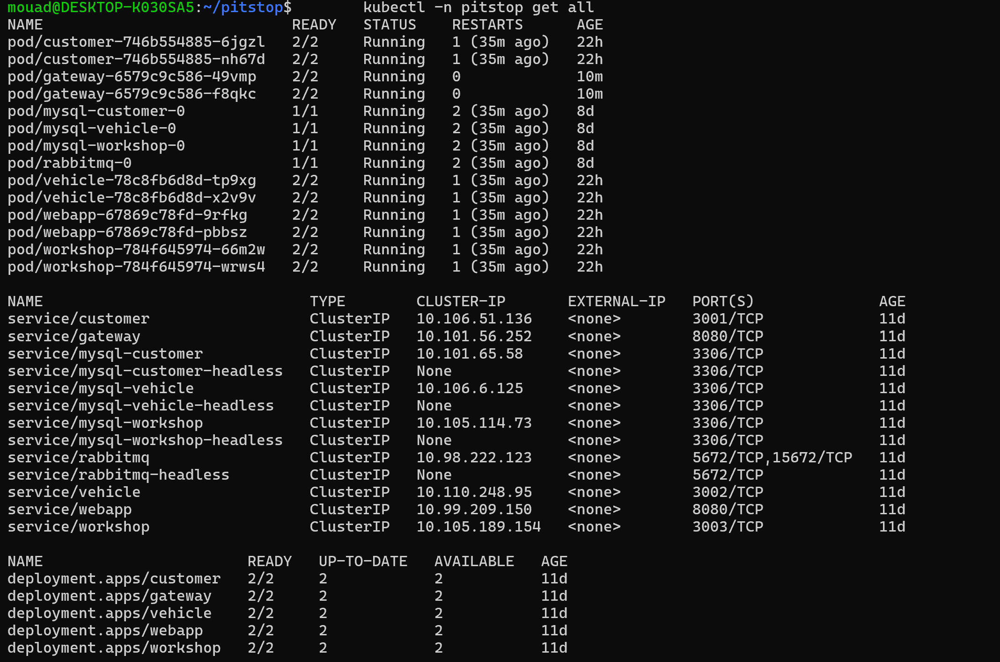

The webapp loaded through a real load balancer is shown in Volet 5
below — the same manifests, unchanged, running the exact same frontend
behind a completely different Ingress implementation.

## Volet 3 — Pipeline & runtime security

Stage order is `security → build → scan → deploy` — a leaked credential
blocks the image from ever being built. Four scanner classes, each
catching something the others structurally cannot:

| Tool | Catches | Gates the pipeline? |
|---|---|---|
| Gitleaks | committed secrets | yes — any finding |
| SonarQube | code quality / SAST | yes — quality gate |
| Trivy (image) | known CVEs in the shipped container | yes — CRITICAL, fixable only |
| Trivy (filesystem) | CVEs in the full dependency lockfile | no — report only, reviewed as backlog |
| OWASP ZAP (DAST) | runtime behavior of the deployed app | yes — FAIL-level rules only |

**The gap between `trivy fs` and `trivy image` turned out to be the
single most instructive number in this phase:** the lockfile scan on
one service reported 50 vulnerabilities (46 HIGH, 4 CRITICAL); the
image actually shipped had 2. The difference is dev-only dependencies
that never leave the build stage — which is also the argument for
gating on the image and not the lockfile.

**DAST found what dependency scanning structurally cannot.** ZAP
flagged a real, exploitable `moment.js` CVE that `dependency-scan` had
been reporting into every pipeline log for weeks without gating —
nobody had read it, because a report-only finding is invisible in
practice. It also flagged Vue 2's end-of-life CVE, accepted as a
documented risk (no patch exists; the app is a precompiled SPA that
never evaluates user input through the vulnerable path).

Secrets are protected on three independent layers, defending three
different attackers: **Sealed Secrets** (defends Git — a reader of the
public repo gets ciphertext), **namespace-scoped RBAC** (defends the
API server — a compromised pod has no `secrets` access), and **etcd
encryption at rest** (defends the disk — a raw etcd snapshot is also
ciphertext). Full detail, including the exact verification for each
layer, is in [`pitstop-devops/docs/security.md`](pitstop-devops/docs/security.md).

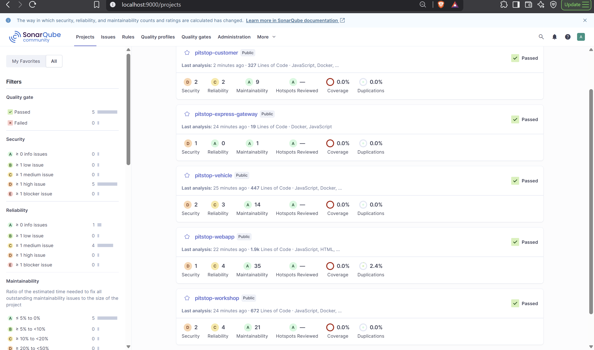

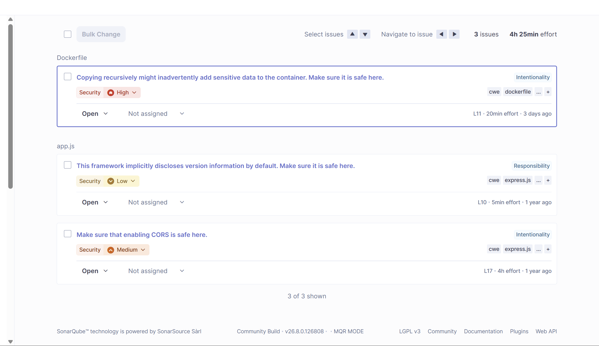
*The CORS and version-disclosure findings shown here are the same
accepted risks documented in `docs/security.md` section 3, not
oversights — this is what that documentation is describing.*

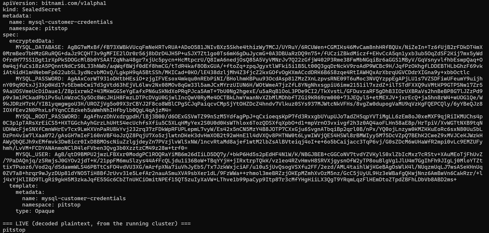

## Volet 4 — Observability

`kube-prometheus-stack` (Prometheus + Grafana + Alertmanager) and Loki
+ Promtail, both installed via Helm outside Argo CD's management (they
ship CRDs; pruning a CRD deletes every custom resource of that kind, so
these are bootstrapped the same way as Sealed Secrets). A
dashboard-as-code ConfigMap, watched by Grafana's sidecar, provisions a
consolidated system + app + logs view automatically on every cluster
rebuild.

**The most valuable finding of this phase was a real incident, not a
demo.** The cluster's iowait climbed to 65%, load average passed 50 on
16 idle-looking cores, and Argo CD's repo-server was being killed by
its own liveness probe every few minutes. Three plausible causes were
investigated and ruled out by measurement (disk fsync latency, Windows
Defender scanning, Prometheus's own scrape load) before the real root
cause surfaced: **the cluster's container had a 3.9 GiB memory cgroup
limit that Kubernetes itself could not see** — `kubectl get node`
reported ~15 GiB of capacity because the kubelet reads `/proc/meminfo`,
which shows the *host's* memory from inside a container, not the
cgroup ceiling. Every workload had been scheduled against a number four
times too large, and the kernel was in permanent page-cache reclaim.
Fixing the actual container memory limit (no cluster rebuild needed)
took iowait from 65% to 0% and load average from 52 to 1.0.

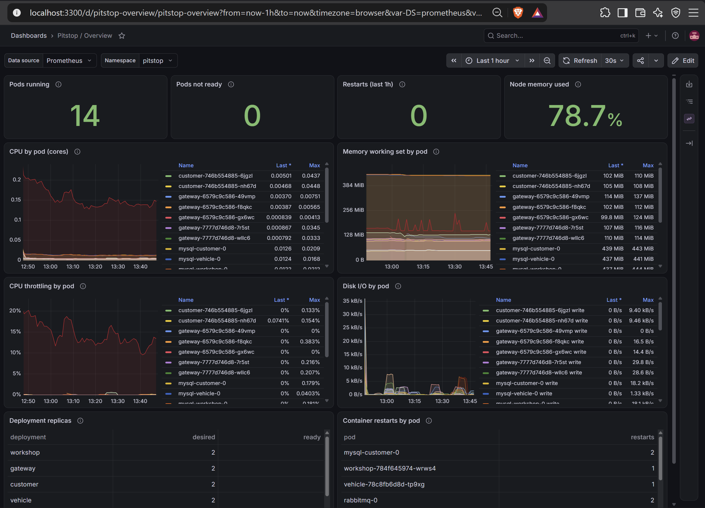

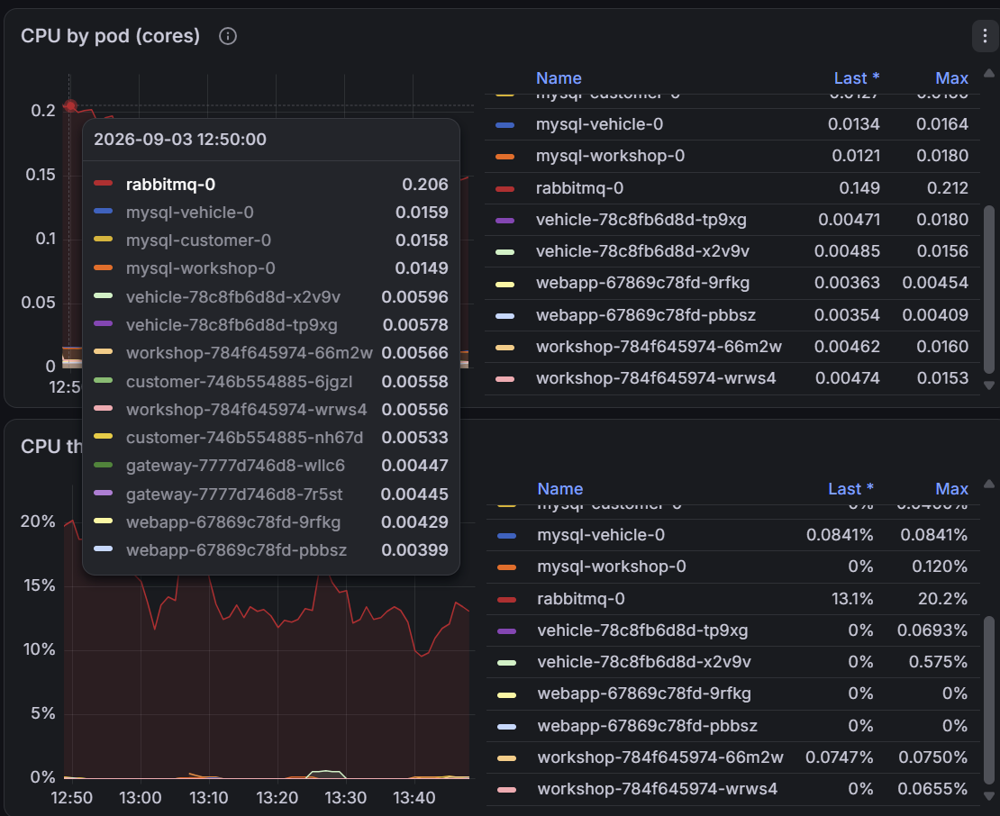

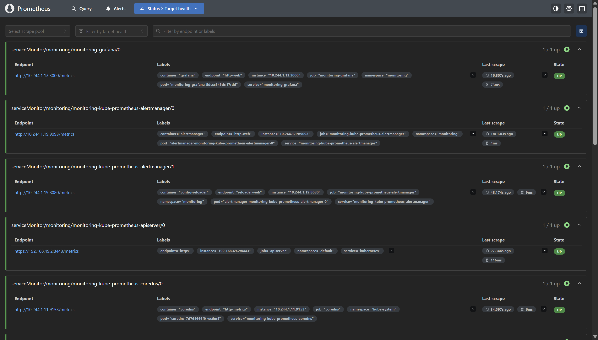

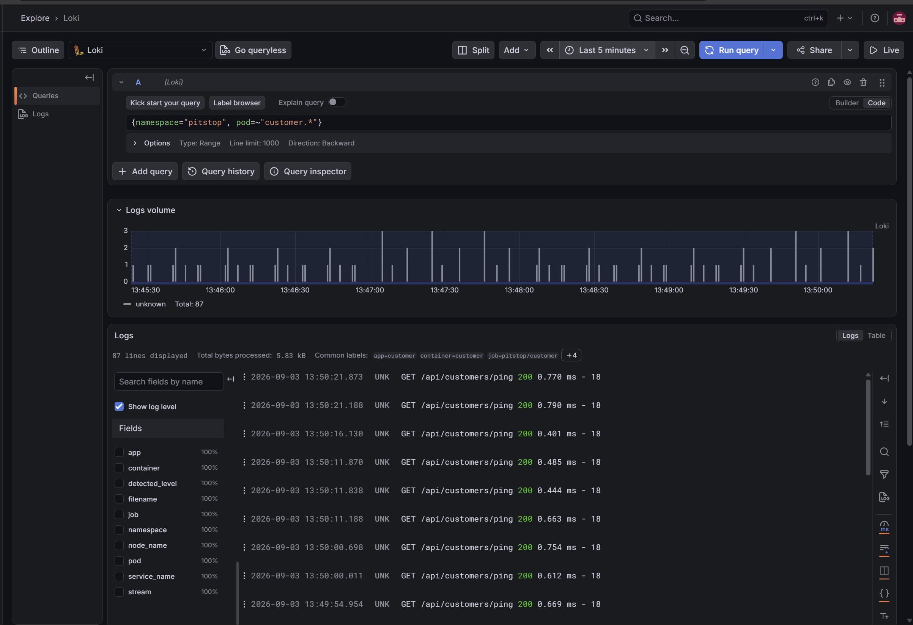

## Volet 4b — Service mesh (Istio)

Istio 1.30.3, sidecar-injected into every `pitstop` workload except the
four data-layer StatefulSets (they speak raw TCP, not HTTP — a sidecar
adds startup and connection-draining risk with no request-level
benefit). Two Istio CRDs do the actual enforcement:

- **`PeerAuthentication`** — namespace-wide `STRICT` mTLS by default,
  with `gateway` and `webapp` explicitly carved out to `PERMISSIVE`
  because both receive traffic directly from the (unmeshed) ingress
  controller, which cannot present an Istio certificate.
- **`AuthorizationPolicy`** — `customer`, `vehicle`, and `workshop` each
  accept traffic **only** from `gateway`'s mesh identity
  (`cluster.local/ns/pitstop/sa/gateway`), enforced independently of
  network reachability.

**Verified as an actual access-control boundary, not configuration that
merely exists:** a direct `wget` from inside the `vehicle` pod straight
to `customer`, bypassing `gateway` entirely, was rejected with `403
Forbidden` — while the legitimate path through `gateway` kept returning
`200` throughout. The two facts side by side are the proof: this is a
real authorization boundary enforced at the network layer by workload
identity, not by hoping every caller behaves.

Every workload in the `kubectl get all -n pitstop` screenshot above
already shows `2/2` — sidecar injected, confirming the mesh is actually
in the traffic path, not just installed.

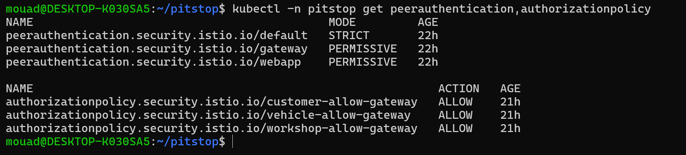

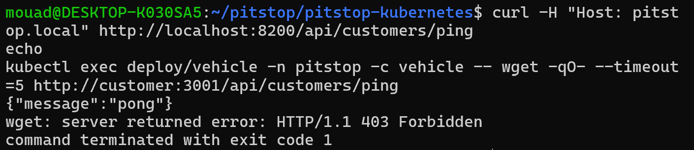

## Volet 5 — Cloud Kubernetes (AWS EKS)

Optional final phase, run against a real AWS account (a $100
promotional credit, not covered by the standard Free Tier) with a cost
guardrail — an AWS Budget with 80%/100% alert thresholds — created
before any billable resource existed.

The core goal: prove the *same* GitOps repository reconstructs the
*same* running application on a real cloud Kubernetes distribution, not
just on a local single-node cluster. Provisioned via Terraform
(`terraform-aws-modules/vpc/aws` + `.../eks/aws`), after an initial
`eksctl` attempt hit a new-account guardrail restricting EC2 launches to
a specific Free-Tier-eligible instance list.

Two EKS-specific failures surfaced and were fixed along the way — not
because the manifests were wrong, but because they encoded assumptions
true on Minikube and false on real cloud infrastructure:

- **Argo CD's sync failed as a single, all-or-nothing unit** because
  this repository accumulated resources from every optional volet
  (Sealed Secrets, Prometheus, Istio CRDs), all of which this
  minimal-scope EKS cluster deliberately lacks. Fixed by excluding those
  paths on the live Application object, without touching the version
  Minikube still syncs from.
- **EKS does not provision persistent volumes out of the box** the way
  Minikube's built-in provisioner does. Fixed properly through
  Terraform: an IRSA (IAM Roles for Service Accounts) role scoped to
  exactly the EBS CSI driver's service account, wired in as a cluster
  addon.

**Extended past the core proof, deliberately, for broader AWS exposure:**
Terraform remote state (S3 + DynamoDB locking), the AWS Load Balancer
Controller replacing the ingress-nginx-provisioned classic ELB with a
real Application Load Balancer, and migrating the `customer` service
from an in-cluster MySQL `StatefulSet` to Amazon RDS — verified with an
actual write followed by a read through the live API, not just a
healthy pod.

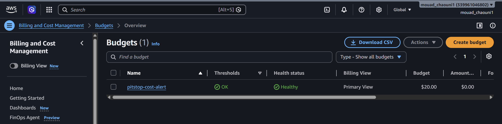

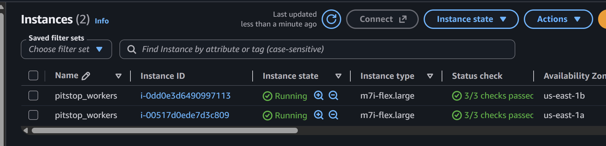

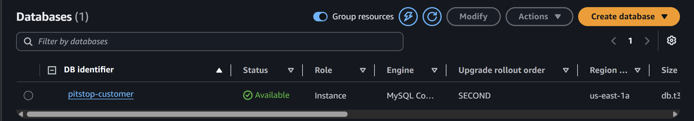

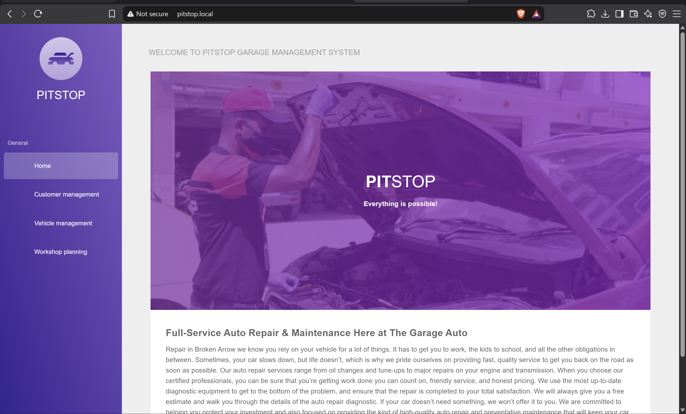

Real write followed by a real read through the live API, not a healthy
pod assumed to be correct:

```
--- before ---
[{"id":1,...,"email":"rds-test@example.com",...}]

--- write ---
Customer undefined has been added successfully

--- after ---
[
  {"id":1,...,"email":"rds-test@example.com",...},
  {"id":2,...,"email":"portfolio-demo@example.com",...}
]
```

The second row (`id: 2`) only exists because the write actually
persisted to RDS — this is a real `INSERT` followed by a real `SELECT`
against AWS infrastructure outside the Kubernetes cluster entirely.

Full teardown sequence and orphaned-resource checklist are documented in
[`pitstop-devops/docs/eks.md`](pitstop-devops/docs/eks.md).

---

## Known, accepted gaps

Two items were identified during a full project review and left open
deliberately rather than silently:

- **Kiali was never installed.** The actual mTLS/authorization security
  goal of Volet 4b was completed and independently verified without it;
  Kiali would only have added a visualization layer on top of controls
  already proven to work.
- **`pitstop-vehicle` never publishes a `vehicle.deleted` event** on its
  message bus, even though `pitstop-workshop` listens for one — deleting
  a vehicle leaves a stale reference in the workshop service's own
  database. A real application-level bug, out of scope for the platform
  work this repository documents.

A complete list of deliberate security trade-offs and their reasoning —
not just these two — is in [`pitstop-devops/docs/security.md`, section 3](pitstop-devops/docs/security.md).
